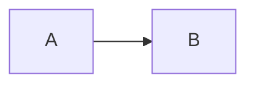

# Markdown

[← Back: Languages](./README.md)

## Text

- `*text*` | `_text_`: _italic_
- `**text**` | `__text__`: **bold**
- `***text***`: _**bold + italic**_
- `~~text~~`: ~~strikethrough~~
- `` `code` ``: `inline code`
- `\*`: escape a special character
- `\` | `<br>`: line break

## Headings

```md
# H1
## H2
### H3
#### H4
##### H5
###### H6
```

### Anchors

Heading anchors: lowercase, spaces → `-`, punctuation removed.

```md
[Headings](#headings)

[Unordered and Ordered lists](#lists)

[Code Blocks](#code-blocks)
```

## Lists

```md
- Unordered
- Items
    - Nested
        - Super Nested

1. Ordered
2. Items
    1. Nested
    2. Nested 2
        1. Super Nested

- [ ] Task
- [x] Task done
```

## Links and images

```md
[text](https://example.com)
[text](https://example.com "Title")
<https://example.com>             autolink

[text][ref]                       reference link
[ref]: https://example.com

[Other note](../courses/README.md)   relative link


[](https://example.com)   linked image
```

## Code blocks

Code:

````md
```python
print("hello")
```
````

Displayed as:

```python
print("hello")
```

When displaying code blocks in markdown as above use four backticks
to wrap a block that itself contains triple backticks.

## Blockquotes

```md
> Quote
>
> > Nested quote
> >
> > > Very nested quote
```

> Quote
>
> > Nested quote
> >
> > > Very nested quote

### GitHub callouts

Code:

```md
> [!NOTE]
> Useful information users should know, even when skimming.

> [!TIP]
> Helpful advice for doing things better or more easily.

> [!IMPORTANT]
> Key information users need to know to achieve their goal.

> [!WARNING]
> Urgent info that needs immediate user attention to avoid problems.

> [!CAUTION]
> Advises about risks or negative outcomes of certain actions.
```

Displayed as:

> [!NOTE]
> Useful information users should know, even when skimming.

> [!TIP]
> Helpful advice for doing things better or more easily.

> [!IMPORTANT]
> Key information users need to know to achieve their goal.

> [!WARNING]
> Urgent info that needs immediate user attention to avoid problems.

> [!CAUTION]
> Advises about risks or negative outcomes of certain actions.

The `[!TYPE]` line must be on its own, and callouts can't be nested.

## Tables (GFM)

```md
| Left | Center | Right |
| :--- | :---: | ---: |
| a | b | c |
| `\|` | escaped pipe | 1 |
```

Columns don't need to be aligned in the source.

## Other

- `---` / `***` / `___` — horizontal rule (needs a blank line before `---`, or it becomes an H2)
- `text[^1]` + `[^1]: note` — footnote (GFM)
- `<!-- comment -->` — hidden comment
- `<details><summary>Title</summary> … </details>` — collapsible section (HTML)
- `<kbd>Ctrl</kbd>` — keyboard key (HTML)
- `$x^2$` / `$$ … $$` — inline / block math (GitHub, Obsidian, etc.)

## Diagrams

````md

````

Rendered by GitHub, Obsidian and many other viewers.

## Front matter

```md
---
title: Note
tags: [a, b]
---
```

YAML at the very top of the file; used by static site generators and Obsidian.
