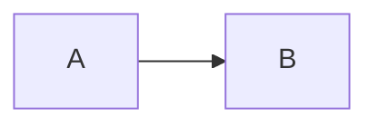

# Markdown

[<- Languages](./README.md)

## Text

- `*text*` | `_text_`: _italic_
- `**text**` | `__text__`: **bold**
- `***text***`: _**bold + italic**_
- `~~text~~`: ~~strikethrough~~
- `` `code` ``: `inline code`
- `\*`: escape a special character
- `\` | `<br>`: line break

## Headings

```md
# H1
## H2
### H3
#### H4
##### H5
###### H6
```

Alternative (H1/H2 only):

```md
Heading 1
=========

Heading 2
---------
```

## Lists

```md
- Unordered
- Items
  - Nested (indent 2–4 spaces)

1. Ordered
2. Items
   1. Nested

- [ ] Task (GFM)
- [x] Done
```

Ordered lists only use the first number; `1.` on every line still counts up.

## Links and images

```md
[text](https://example.com)
[text](https://example.com "Title")
<https://example.com>             autolink

[text][ref]                       reference link
[ref]: https://example.com

[Other note](../courses/README.md)   relative link
[Section](#code-blocks)              heading anchor


[](https://example.com)   linked image
```

Heading anchors: lowercase, spaces → `-`, punctuation removed.

## Code blocks

````md
```python
print("hello")
```
````

Indenting four spaces also makes a code block (no syntax highlighting).
Use four backticks to wrap a block that itself contains triple backticks.

## Blockquotes

```md
> Quote
>
> > Nested quote
```

GitHub callouts:

```md
> [!NOTE]
> Also TIP, IMPORTANT, WARNING, CAUTION
```

## Tables (GFM)

```md
| Left | Center | Right |
| :--- | :---: | ---: |
| a | b | c |
| `\|` | escaped pipe | 1 |
```

Columns don't need to be aligned in the source.

## Other

- `---` / `***` / `___` — horizontal rule (needs a blank line before `---`, or it becomes an H2)
- `text[^1]` + `[^1]: note` — footnote (GFM)
- `<!-- comment -->` — hidden comment
- `<details><summary>Title</summary> … </details>` — collapsible section (HTML)
- `<kbd>Ctrl</kbd>` — keyboard key (HTML)
- `$x^2$` / `$$ … $$` — inline / block math (GitHub, Obsidian, etc.)

## Diagrams

````md

````

Rendered by GitHub, Obsidian and many other viewers.

## Front matter

```md
---
title: Note
tags: [a, b]
---
```

YAML at the very top of the file; used by static site generators and Obsidian.
